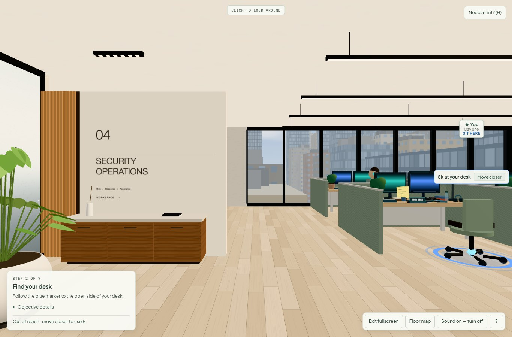
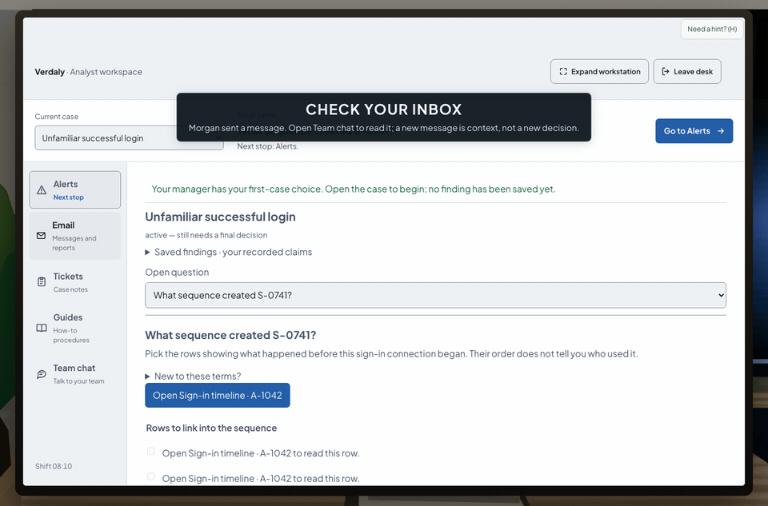

# CareerDive

**Try a shift, don't just read a job description.** CareerDive is a browser-based career-exploration
simulator where you *do* selected tasks from a real job instead of reading about it. The current
playable experience is a Junior Cybersecurity Analyst shift inside a fictional company, Verdaly
Technologies — walk a 3D office, sit at a workstation, investigate a suspicious-login alert using
desk tools, weigh evidence, and hand off your findings.

> It's a short, honest slice of selected tasks — not a complete account of a career, and not a
> "career-fit score." The goal is to let someone *feel* what a kind of work is like before committing to it.

## Demo

[Open the live demo](https://careerdive.onrender.com/)

The walkthrough is: **Start your first day → Security Operations → arrival film →
walk to your desk → sign in → investigate with Desk OS**. Other careers are Workshop
previews, not playable simulations.





These captures show the current source running locally with the development API.
See [capture details](docs/media/README.md) and [local setup](#local-development).

---

## Why I built it

Most career advice for students is reading: job descriptions, "day in the life" articles, quizzes
that spit out a personality label. None of that lets you actually *try the work*. CareerDive is my
attempt to close that gap for middle- and high-schoolers (13+): a free, no-signup, anonymous
simulation of real on-the-job tasks, so you can decide if a path interests you by doing a piece of
it — not by taking a test about yourself.

## What it does

- **A playable first shift.** Enter a 3D office, reach your desk, and work a real cybersecurity case
  through an in-sim "Desk OS" (email, alerts, record search, inventory, tickets, team chat).
- **Reason about evidence, not trivia.** You review signals, work within approval boundaries,
  document what's still uncertain, and write a handoff for the next analyst. There's no quiz score —
  the debrief reflects *how you reasoned*.
- **An honest debrief.** It describes what you did and what you observed, explicitly not a hiring
  decision, certification, or aptitude diagnosis.

## Engineering highlights (what's interesting under the hood)

- **Deterministic simulation core.** All state, time, consequences, and evidence live in a pure
  TypeScript core (`packages/core`). Replaying the same seed + interaction log reproduces the exact
  same state — which makes the whole thing testable and the debrief trustworthy.
- **Typed client/server boundary.** The browser renders an *authorized projection* of state and
  submits typed actions over tRPC; the server owns the truth. Shared Zod schemas (`packages/schemas`)
  keep the contract honest end to end.
- **Real-time 3D in React.** The workplace is Three.js / React Three Fiber with adaptive quality
  tiers and reduced-motion support, including a depth-parallax city skyline behind glass curtain walls.
- **Transactional persistence.** PostgreSQL transactions and revision checks protect concurrent
  simulation writes. A checksummed migration runner uses an advisory transaction lock to serialize
  migration attempts. The repository includes hand-authored SQL migrations and transactional queries.
- **Anonymous exploration.** No signup; anonymous authentication provides session ownership.
  Simulation inputs use predefined choices, dialogue is authored, and the runtime calls no AI provider.
  Render build defaults enable first-party aggregate milestone counts; no third-party analytics SDK.
- **Verification at several layers.** Vitest covers simulation rules, API behavior, React components,
  and renderer parity. Playwright separately checks browser flows. PostgreSQL integration tests
  require explicitly configured disposable databases and otherwise skip; see [verification](#scripts-and-verification).

## Tech stack

TypeScript monorepo (pnpm workspaces + Turborepo) · **Web:** React 19, Vite, Three.js / R3F ·
**API:** Fastify + tRPC · **Data:** PostgreSQL via Drizzle, Supabase (anonymous auth) ·
**Testing:** Vitest + Playwright · **Deploy:** Docker on Render.

---

## Local development

Requires **Node.js 24+** and **pnpm 11** (version pinned in `package.json`).

```bash
pnpm install --frozen-lockfile
pnpm dev
```

| Service | Address |
| --- | --- |
| Web client | `http://localhost:5173` |
| API health | `http://localhost:3001/health` |
| tRPC API | `http://localhost:3001/trpc` |

After startup, verify local services with `pnpm check:dev`, open the web client, click
**Start your first day**, and select **Security Operations** on the floor map. After the arrival
film, use WASD to reach the desk and E to sit. The fictional workstation's sign-in details appear
on its sticky note. Local dev runs without `DATABASE_URL` (uses a
process-local in-memory repository). Production requires PostgreSQL + Supabase config; see the
[environment contract](docs/ops/environment-contract.md). Ports 5173 and 3001 must be free (Vite uses
a strict port):

```bash
lsof -nP -iTCP:5173 -sTCP:LISTEN
lsof -nP -iTCP:3001 -sTCP:LISTEN
```

## Architecture

TypeScript monorepo managed by pnpm workspaces and Turborepo.

| Location | Responsibility |
| --- | --- |
| `apps/web` | React 19 + Vite web client; Three.js / R3F workplace rendering; public career pages and accessible recovery workspace |
| `apps/server` | Fastify + tRPC API; authenticated session ownership, PostgreSQL persistence through Drizzle, Supabase Auth integration |
| `packages/core` | Deterministic state transitions, task rules, scheduling, queries, and replay |
| `packages/schemas` | Shared Zod schemas and typed contracts |
| `packages/career-packs` | Loading and validation of authored career packs |
| `packages/safety` | Validation of user-facing text and exploration guardrails |
| `packages/evidence`, `packages/pathways` | Evidence records and career pathway data |
| `packages/testing` | Shared simulation verification and renderer parity contracts |
| `packages/video` | Remotion compositions rendered to media files separately from the web runtime |
| `content/packs` | Authored career scenarios, records, tasks, and review metadata |

The deterministic core owns simulation state, time, consequences, evidence, and available knowledge;
replaying the same seed + interaction log produces the same state. Workplace dialogue is prewritten
and selected by deterministic rules. The browser renders the authorized client projection and submits
typed actions.

## Scripts and verification

```bash
pnpm lint
pnpm typecheck
pnpm test
pnpm build
```

| Command | Purpose |
| --- | --- |
| `pnpm dev` | Start the web and API development services |
| `pnpm check:dev` | Check local ports and API connectivity |
| `pnpm test` | Run the default Vitest regression suite |
| `pnpm test:golden-path` | Start local services and run Playwright browser checks |
| `pnpm build` | Build workspace packages and the production web client |

Browser checks and media capture require Playwright's browsers (media capture also needs `cwebp`).
Ordinary development and the default tests do not require cloud credentials.

`pnpm test` runs the default Vitest suite; it does not run Playwright or intentionally failing
development contracts (`pnpm test:red`). Live-database tests skip without their test database
variables. GitHub's [CI workflow](https://github.com/zaidkan/CareerDive/actions/workflows/ci.yml)
runs lint, type checking, the default tests, and the production build; check the run for the
commit being reviewed before treating it as verified.

## Deployment

`render.yaml` defines Docker web/API services for Render, with PostgreSQL and anonymous authentication
via Supabase. Automatic deployment is disabled in the blueprint; its presence does not establish
which commit a live service runs. Compare each service's successful deployed commit with the
intended release before redeploying, especially if production was pinned to a fix on another branch.
README, screenshots, and test-only changes do not require a production redeploy.

For a web-client fix, merge the passing PR, then open the existing web service in Render.
Set its deployment branch to `main`, set the web build argument `BUILD_SHA` to the full
commit being released, and use **Manual Deploy → Deploy a specific commit** for that same
commit. `BUILD_SHA` labels diagnostics; it does not select the source revision. Wait for
**Live**, verify the deployed commit in Render, then check startup, arrival film, and reload
in a fresh browser tab. Deploying a specific commit disables automatic deployment; configure
**After CI Checks Pass** separately if you want future pushes to deploy automatically.
The startup/film fix changes only the web client; it requires a web rebuild and deploy.

Database migrations use a checksummed runner — inspect the plan before applying:

```bash
pnpm --filter @sim/server db:plan     # offline, does not connect
pnpm --filter @sim/server db:verify   # verify applied history
pnpm --filter @sim/server db:migrate  # apply pending (requires DATABASE_URL)
```

See the [environment contract](docs/ops/environment-contract.md) for build-time origins, runtime
configuration, and the web/API boundary (web `VITE_*`/`SITE_ORIGIN`/`BUILD_SHA` are **build args**).

## Privacy

Intended for ages 13+, with anonymous authentication and predefined simulation inputs. Optional
support reports are separate from simulation input. The web build can enable first-party aggregate
milestone counts; Render defaults enable them. No third-party analytics SDK or runtime AI provider.
Database-backed servers run hourly cleanup for simulation sessions older than 90 days; this does
not delete authentication users, support reports, or career requests. See
[retention details](docs/ops/simulation-retention.md), [Privacy Policy](apps/web/src/site/legal/privacy.md),
and [Terms](apps/web/src/site/legal/terms.md).

## Documentation

- [Contributing](CONTRIBUTING.md) — setup, conventions, verification
- [Public career content](docs/content/public-career-content-packet.md)
- [First-shift content map](docs/content/cybersecurity-first-shift-map.md)
- [Art direction](docs/ui-1-art-direction.md)

## License

MIT. See [LICENSE](LICENSE).
