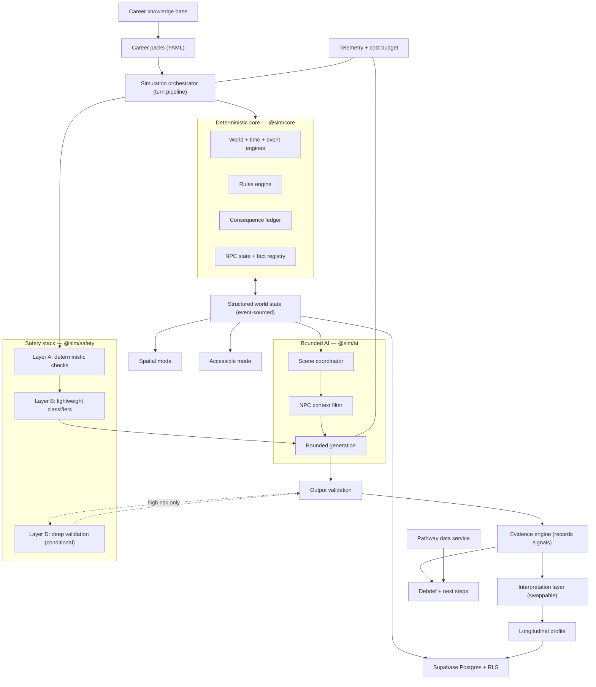
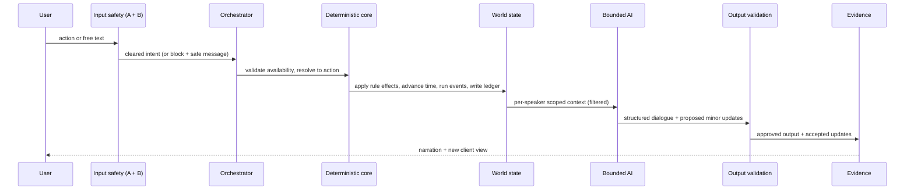

# Career Simulation Platform — Build Specification

**Audience:** the coding agent (Claude Code) that will implement this project, using the Superpowers methodology.
**Status:** authoritative build spec. Where this doc and the two source PDFs disagree, this doc wins, because it resolves open decisions the PDFs left implicit.
**Companion docs:** `Career_Simulation_Platform_Overview.pdf`, `Architecture_and_Governance_Requirements.pdf`. Read them for product rationale. This doc is the technical contract.

---

## 0. How to use this document

This spec is the input to the Superpowers workflow, not a replacement for it. Run the normal sequence: brainstorm against this doc, write a plan of small (2 to 5 minute) tasks, then implement test first (RED, GREEN, REFACTOR), each non-trivial unit in its own git worktree, with code review between tasks.

Three rules override speed at all times:

1. **The backend owns truth. The language model never does.** Time, state, actions, consequences, rules, NPC knowledge, and safety are all decided by deterministic code. The model only produces dialogue and narration, returned through a validated schema. If you are ever tempted to let the model decide what happened, stop.
2. **Build the walking skeleton first.** Get one room, one NPC, one event working end to end with zero AI before adding any generation. See Section 14.
3. **Honor the product guardrails in Section 1 in code, not just in copy.** They are testable invariants, not marketing.

Do not over-build. YAGNI applies. Every abstraction in this doc earns its place by being used in the first vertical slice or by being a named extension point that the slice exercises at least once.

---

## 1. Product guardrails (testable invariants)

These must be enforced by code and covered by tests. They are not optional.

| ID | Guardrail | How it is enforced |
|----|-----------|--------------------|
| G1 | No numeric assessment meters are ever shown to the user (no "Manager trust: 72%", no "Stress: 43%"). | Hidden-state variables live in a server-only namespace that the view layer cannot read. Lint rule plus an integration test that scans rendered payloads. |
| G2 | No fake precision. User-facing evidence uses confidence categories, never decimals or percentages. | The debrief generator accepts only the `ConfidenceLevel` enum. A test rejects any numeric skill score in user-facing output. |
| G3 | Exploration, not diagnosis. The product never tells a user what they should become or asserts a stable trait from limited data. | Debrief templates are claim-bounded (Section 10). A prohibited-phrase check runs in output validation. |
| G4 | An NPC never references information it is not permitted to know. | Pre-generation redaction plus post-generation leakage check (Section 8). Adversarial tests in CI. |
| G5 | Safety runs before the simulation responds, and is never bypassed for latency. | The turn pipeline cannot emit output that skipped Layers A and B. Graceful fallback uses approved prewritten responses (Section 9). |
| G6 | Spatial mode and accessible mode expose the same actions and consequences. | Both modes consume one action API. A parity test asserts identical available-action sets for a given state. |
| G7 | The platform is not used for high-stakes decisions (rejection, ranking, placement, hiring) in any early phase. | No API exposes ranking or compatibility outputs. Enforced by absence plus a documented policy gate. |
| G8 | Reflection data is private by default and never auto-shared with parents, schools, or counselors. | Row-level security default-deny on reflection rows. Sharing requires an explicit grant (Section 11). |

---

## 2. Architecture at a glance

The system is a deterministic simulation server with a bounded generative layer bolted to the side, a content pipeline that feeds it configuration, and two interchangeable front ends that are thin views over server-authoritative state.



The single most important relationship in that diagram is `CORE <--> WS`: the deterministic core is the only writer of canonical state. Everything else reads filtered views of it.

---

## 3. Technology stack (specific tools, and how each is used here)

Pick boring, typed, and testable. One language end to end so the agent and the human reviewers carry one mental model.

- **Language: TypeScript, strict mode, everywhere.** Shared domain types between server and client are the backbone of correctness. No `any` in core packages; `eslint` rule `@typescript-eslint/no-explicit-any` set to error in `@sim/core`, `@sim/schemas`, `@sim/ai`, `@sim/evidence`.
- **Monorepo: pnpm workspaces + Turborepo.** pnpm gives fast, content-addressed installs and strict dependency boundaries. Turborepo runs `build`, `test`, `lint`, `typecheck` across packages with caching. Use it so the AI-consistency suite and the unit suite are separate, cacheable pipelines.
- **Schemas and validation: Zod.** Every state shape, every action, every career-pack field, and every LLM input and output is a Zod schema. Derive TypeScript types with `z.infer`. Validate at every trust boundary (HTTP in, LLM out, pack load). A value that has not been through a Zod parse is untrusted.
- **Client/server transport: tRPC.** End-to-end typed procedures remove a whole class of contract bugs and let the agent refactor across the boundary safely. Procedures wrap Zod input/output schemas. Use tRPC subscriptions or simple request/response; this is turn-based, so request/response is enough.
- **Server runtime: Node 20+ with Fastify as the tRPC HTTP adapter.** Fastify for speed and a clean plugin model. Keep the HTTP layer thin: it authenticates, then calls the orchestrator.
- **Persistence: Supabase.** Postgres for all durable data, Supabase Auth for accounts, Row-Level Security for the access matrix (Section 11), and Supabase Storage for pre-generated media (scene images, voice clips). RLS is the security boundary for guardrails G7 and G8; do not rely on application code alone.
- **DB access: Drizzle ORM.** SQL-first, fully typed, migrations as code (`drizzle-kit`). RLS policies are written as SQL migrations alongside the Drizzle schema so the security model is versioned with the tables.
- **LLM provider: Anthropic API via `@anthropic-ai/sdk`.** Model roles, not hardcoded model strings scattered through the code. Centralize in one config:
  - **Classifier / moderation role:** Claude Haiku 4.5 (`claude-haiku-4-5`). Fast and cheap, used for Layer B.
  - **Primary dialogue role:** Claude Sonnet 4.6 (`claude-sonnet-4-6`). The main narration and NPC dialogue call.
  - **Deep validation role:** Claude Opus 4.8 (`claude-opus-4-8`). Conditional Layer D only.
  Use **tool use with an `input_schema` (JSON Schema generated from the Zod contract)** to force structured output. Always set `tool_choice` to the single output tool so the model must return the contract. Confirm current model identifiers and tool-use syntax against `https://docs.claude.com` before wiring; treat the strings above as defaults to verify, not gospel.
- **LLM behind an interface.** Define `LlmProvider` (Section 8.5) and put Anthropic behind it. The slice ships with the Anthropic implementation; the interface keeps you from vendor lock and makes tests use a fake.
- **Determinism: a seeded PRNG.** Use a small, explicit generator (for example a `mulberry32`/`xorshift128` implementation you own, or `seedrandom`). The core never calls `Math.random()`. The seed is stored per session so a run is reproducible.
- **Testing: Vitest.** Unit and integration tests for everything; the pure core makes this trivial. The AI-consistency harness (Section 12) is a separate Vitest project with its own config and longer timeouts.
- **Logging and telemetry: pino** for structured logs, plus a `telemetry` table in Postgres for per-turn cost and latency (Section 13). Do not invent a metrics platform yet; Postgres plus a dashboard query is enough to answer "is this commercially sustainable."
- **Caching: start in-process, design for Redis.** Deterministic responses and pre-generated NPC lines are cached behind a `Cache` interface with an in-memory implementation first. Swap to Redis when a second server instance exists. Do not add Redis on day one.
- **Frontend: React + Vite + TypeScript, single app.** All three render targets live in one React app over one `SimulationClient`: the 2D work surface (the professional-systems screens), the accessible structured mode, and the low-poly 3D navigation shell. Tailwind is fine for styling; keep it out of `@sim/core`.
- **3D navigation shell: React Three Fiber (with `drei` helpers).** This is the chosen engine. It is Three.js expressed as React components, so the walkable low-poly shell is just another `ViewAdapter` in the same app, sharing the same client, types, build pipeline, and deploy as the work surface and the accessible mode, with no separate engine, no WebGL embed, and no JS-to-engine state bridge. It renders natively in the browser (no WASM payload, no cross-origin isolation headers, no Safari WebGL2 export caveats). Author low-poly assets in Blender and import as glTF (use `gltfjsx` to turn models into components, Draco compression and instancing for size). Reserve a dedicated engine (Godot or Unity) only for a future physical-career module that genuinely needs heavy, physics-rich 3D; because the shell is a view adapter, such a module can be embedded later without disturbing the core. See Section 17 for the rendering model.

---

## 4. Repository layout and module boundaries

A monorepo with a pure core at the center. Dependencies point inward: apps depend on packages, packages never depend on apps, and `@sim/core` depends on nothing but `@sim/schemas`.

```
career-sim/
  packages/
    schemas/        # @sim/schemas  — Zod schemas + inferred types. Zero logic.
    core/           # @sim/core     — deterministic engine. No I/O, no network, no LLM.
    career-packs/   # @sim/career-packs — YAML loader, validator, registry.
    ai/             # @sim/ai       — context filter, scene coordinator, generation, LlmProvider.
    safety/         # @sim/safety   — layered safety stack, budget enforcer, fallback.
    evidence/       # @sim/evidence — signal recording, confidence taxonomy, mismatch detection.
    pathways/       # @sim/pathways — pathway data model + staleness logic.
    testing/        # @sim/testing  — AI-consistency harness, fakes, fixtures.
  apps/
    server/         # tRPC + Fastify orchestrator, persistence, auth, telemetry wiring.
    web/            # React client: spatial mode, accessible mode, tutorial, debrief.
    authoring/      # (Phase 2) tooling for SMEs and writers to build/review packs.
  content/
    packs/          # versioned career pack YAML, one folder per career.
    pathways/       # pathway data records by career + jurisdiction.
```

### Extension points (the interfaces that make this expandable)

Every place the system is meant to grow is a named interface. Adding a career, a system, a rhythm, a mode, a provider, or a safety check means implementing one of these, never editing the core.

- `SystemModule` — a reusable professional system (inbox, dashboard, ticket queue). One implementation, configured per career. The inbox module renders parent emails, patient messages, or client requests depending on config.
- `EventTemplate` — a parameterized event (trigger conditions, deadline, escalations, skill signals, prohibited outcomes). Packs instantiate templates.
- `NpcArchetype` — manager, senior colleague, client, and so on, with role, goals, communication style, and a knowledge profile.
- `ScenarioRhythm` — a phase state machine (the six rhythms A to F in the overview). A pack selects one or more.
- `SafetyCheck` — a pluggable check that runs in Layer A or B.
- `LlmProvider` — the generation backend.
- `EvidenceSignal` — a typed observation the engine can emit.
- `ViewAdapter` — a front-end mode (spatial, accessible, and future modes) over the shared client.

Keep each interface in `@sim/schemas` or its owning package, documented with one example implementation in the slice.

---

## 5. The deterministic core (`@sim/core`)

This package is pure: given a state and an action, it returns a new state and a list of effects, with no side effects and no I/O. That purity is what makes it testable and replayable. It is the heart of the project, so build it first and build it test-first.

### 5.1 World state shape

Define everything as Zod. A sketch (not exhaustive; the agent expands it):

```ts
// @sim/schemas/state.ts
export const Location = z.object({
  id: z.string(),
  connectedLocations: z.array(z.string()),
  interactables: z.array(z.string()),
});

export const HiddenState = z.object({         // server-only, never serialized to the client
  stress: z.number(), fatigue: z.number(), trust: z.record(z.string(), z.number()),
  reputation: z.number(), cognitiveLoad: z.number(), taskBacklog: z.number(),
  accuracy: z.number(), riskExposure: z.number(),
});

export const WorldState = z.object({
  sessionId: z.string(),
  seed: z.number(),                            // for deterministic RNG
  simClock: z.number(),                        // simulated minutes elapsed
  currentLocation: z.string(),
  locations: z.record(z.string(), Location),
  facts: z.record(z.string(), Fact),           // fact registry, see 8.2
  npcs: z.record(z.string(), NpcState),
  events: z.array(EventInstance),
  ledger: z.array(ConsequenceEntry),
  pacingMode: PacingMode,                      // standard / extended / pause-compatible / no-timer / practice
  hidden: HiddenState,                         // partition that the view layer cannot access
});
```

`hidden` is a separate partition for guardrail G1. Serializers for the client take `WorldState` and return a `ClientView` that structurally cannot include `hidden`. Write that as a type-level guarantee plus a runtime test.

### 5.2 The turn pipeline

The orchestrator runs a fixed, ordered pipeline. Each stage is a typed function over a `TurnContext`. Stages that are deterministic live in `@sim/core` and need no LLM; AI stages live in `@sim/ai`. The pipeline is the central abstraction of the whole system.



Stage order, with owner package:

1. **Input safety** (`@sim/safety`): Layer A deterministic checks, then Layer B classifiers. Blocks or sanitizes before anything else.
2. **Intent resolution** (`@sim/core` + a thin `@sim/ai` helper): structured UI actions pass straight through. Free text resolves to either (a) a question directed at an NPC, or (b) an attempt at one of the currently available actions, or (c) a graceful refusal if it maps to nothing available. The available-action set is computed deterministically from state.
3. **Action validation** (`@sim/core`): is this action available in this state for this actor? Reject otherwise.
4. **Rules engine** (`@sim/core`): compute deterministic effects and the next state. Pure.
5. **Time advance** (`@sim/core`): advance `simClock` by the action's simulated cost (Section 6).
6. **Event engine** (`@sim/core`): evaluate triggers, escalations, expiries, delayed effects.
7. **Consequence ledger** (`@sim/core`): append immediate effects and schedule delayed ones.
8. **Scene coordination** (`@sim/ai`): decide which NPC(s) may respond and assemble per-speaker scoped context.
9. **Context filtering** (`@sim/ai`): pre-generation redaction of facts each speaker may not know.
10. **Bounded generation** (`@sim/ai`): one primary LLM call per responding speaker, returning the structured contract.
11. **Output validation** (`@sim/safety` + `@sim/core`): leakage check, contradiction check, rule compliance, prohibited-phrase check; conditionally invoke Layer D.
12. **Evidence recording** (`@sim/evidence`): emit typed behavioral and outcome signals. Reflection captured separately when prompted.
13. **Telemetry** (`apps/server`): record cost, tokens, latency, cache hits, validation calls.
14. **View assembly** (`apps/server`): produce the `ClientView` and return it.

Implement the pipeline as an explicit array of stages so it is trivially unit-testable and so individual stages can be skipped in the walking skeleton (stages 8 to 11 are absent until AI is added).

### 5.3 Determinism and replay

Two non-negotiable decisions, made now:

- **Event sourcing.** Persist an append-only `action_log` per session (the action plus the accepted state delta). The current `WorldState` is a fold over that log. Snapshot periodically for performance. This gives replay for free.
- **Seeded RNG.** All randomness in the core flows through one seeded generator stored on the session. No `Math.random()` anywhere in `@sim/core` (lint rule to forbid it).

Replay testing (Section 12) re-runs an action log and compares **state transitions, not generated text**, because dialogue is legitimately stochastic.

---

## 6. Time engine

Time advances primarily through actions, not wall-clock. Each action declares a simulated cost (reading a document is 10 minutes, walking to another department is 5, completing a report is 30). Meetings begin at specified simulated times; delayed tasks expire after a number of actions or a simulated-time threshold.

Real-time pressure is an **optional pacing mode**, never required for baseline assessment. Support, at minimum: standard, extended-time, pause-compatible, no-hard-timer, and practice. Store the pacing mode on the session and on every evidence record. Never compare response speed across incompatible modes. What may be measured regardless of mode: whether the user identifies urgency, what they prioritize, whether they seek help, whether they communicate delays, and whether they notice deteriorating conditions.

---

## 7. Events and consequences

- **Event engine.** `EventTemplate` defines trigger conditions, deadline, priority, possible escalations, related characters, affected systems, skill signals, resolution conditions, prohibited outcomes, and accuracy references. Events can trigger, wait, escalate, expire, combine, block another task, produce delayed effects, resolve quietly, or remain incomplete at end of shift. Not every event escalates; the rhythm decides.
- **Consequence ledger.** Every meaningful action records immediate effects and may schedule delayed effects keyed to a future simulated time. The ledger supports persistence, replay, explanation, testing, debrief evidence, and cross-session patterns. It is the spine of the debrief, so make it richly queryable.

---

## 8. The bounded AI layer (`@sim/ai`)

The model writes words. It does not run the world. Everything here exists to keep that true.

### 8.1 What the model may and may not do

May generate: dialogue wording, environmental description, character tone, follow-up questions, minor scene variation, low-risk secondary interactions.

May never change: professional procedures, safety requirements, credentialing facts, major consequence logic, core scenario objectives, skill mappings, NPC knowledge permissions, legal or ethical rules. These are deterministic and live in the core.

### 8.2 Fact registry and NPC knowledge isolation

A `doesNotKnow` field on an NPC is not sufficient, because models infer and repeat what they are given. Isolation must happen **before** generation.

- Every meaningful fact has an ID and visibility rules: `{ factId, knownBy: string[], notKnownBy: string[], visibility }`.
- The **context assembly** for a given speaker is: full world state, then an access-control filter, then only the facts that speaker may know, then only that speaker's memory, then current goals and emotional state, then permitted dialogue boundaries. The prompt is built from that filtered context only.
- **Pre-generation redaction:** restricted facts are removed from the prompt, not merely flagged.
- **Post-generation leakage check:** generated dialogue is scanned against restricted fact IDs before display (Layer A check in output validation).
- **Adversarial tests** (Section 12) deliberately try to make NPCs reveal hidden information, reference unseen events, or infer confidential facts.

### 8.3 Scene coordinator (multi-NPC)

Deferred past the first single-NPC slice (Section 14), but designed now so it is not retrofitted.

- Distinguish **public scene memory** (anything present participants could observe or hear), **private NPC memory** (from prior private conversations, role-specific systems, confidential documents), and **shared subgroup memory** (known to some but not all).
- A rule-based coordinator decides which NPC has reason to speak, whether more than one responds, whether one interrupts, and what each may reference. Each speaking NPC gets an **independently scoped context**; a second NPC receives only the first NPC's publicly spoken line and publicly observable reactions, never the first NPC's private reasoning.
- An optional narrator component describes body language and public consequences, never private thoughts (unless an intentional omniscient style is chosen).

### 8.4 Structured generation contract

The model returns data through a Zod-validated contract, never free prose that the system parses loosely.

```ts
export const NpcTurnOutput = z.object({
  dialogue: z.string(),
  tone: z.enum(["neutral","concerned","impatient","warm","curt","encouraging"]),
  referencedFactIds: z.array(z.string()),            // must be a subset of permitted facts
  proposedMinorStateUpdates: z.array(z.object({       // backend may accept, reject, or modify
    field: z.enum(["npcMood"]),                       // whitelist only
    value: z.string(),
  })),
});
```

The backend validates `referencedFactIds` against the permitted set (reject on violation) and applies only whitelisted updates. The model's proposals are suggestions; the deterministic core decides.

### 8.5 Provider interface

```ts
export interface LlmProvider {
  generate(input: {
    role: "classifier" | "primary" | "deepValidation";
    system: string;
    messages: Message[];
    outputSchema: ZodTypeAny;   // enforced via tool use input_schema
    maxTokens: number;
  }): Promise<{ value: unknown; usage: TokenUsage }>;
}
```

Anthropic implementation ships with the slice. A `FakeLlmProvider` returning canned, schema-valid outputs powers fast unit tests.

---

## 9. The safety stack (`@sim/safety`)

Eight conceptual checks, but never eight large-model calls per line. Layer the work by cost.

- **Layer A — deterministic.** NPC fact visibility, available-action enforcement, restricted state transitions, professional-rule enforcement, known prohibited outcomes, structured-output and schema validation, prohibited-phrase scan (for G2 and G3). No LLM.
- **Layer B — lightweight classifiers (Haiku role).** Input moderation, off-topic detection, harassment detection, prompt-injection detection, output safety classification, simple fact-reference validation.
- **Layer C — primary generation (Sonnet role).** One main call for context-sensitive dialogue or narration.
- **Layer D — conditional deep validation (Opus role).** Invoked only when: the turn concerns safety-critical procedures, the output references restricted facts, a Layer B checker has low confidence, the user asked an unusually open-ended question, the scenario entered a high-risk state, or the output contains unsupported occupational claims. Most turns never reach Layer D.

**Budget enforcer.** A per-session cost ceiling is enforced in code as a circuit breaker, not merely measured. When a session approaches the ceiling, the orchestrator degrades gracefully (more cached and deterministic responses, fewer Layer D calls) rather than overspending. Configure the ceiling per career pack.

**Graceful fallback.** If validation services are slow or unavailable: use an approved prewritten response, pause open-ended dialogue, continue deterministic interactions, and never show unvalidated AI output. Safety is never bypassed to preserve responsiveness (guardrail G5).

**Input safety vs in-world consequence.** An unprofessional in-game action may produce an in-world consequence (loss of trust). Genuinely harmful user content is handled by the safety stack before the simulation responds and is never treated as an interesting gameplay choice. Self-harm signals route to an escalation path, not an NPC reply.

---

## 10. Evidence and longitudinal profile (`@sim/evidence`)

This is the scientific core and the most over-claimable part of the product. The architecture enforces humility.

### 10.1 Recorder vs interpreter (a hard boundary)

- The **evidence engine records** typed, raw observations only: `EvidenceSignal` values with provenance (which action, which event, which session, which pacing mode). It draws no psychological conclusions.
- A **separate, swappable interpretation layer** turns signals into provisional, confidence-aware statements. It is owned by the research workstream and gated: until validated, it produces only exploratory language. Swapping the science must not require touching the engine.

Three evidence types, kept distinct: **behavioral** (what the user did), **outcome** (what resulted), and **reflective** (how the user experienced it). Competence and enjoyment are stored separately and never collapsed. A user can calm an angry customer well and still report it as draining; both facts survive.

### 10.2 Confidence taxonomy (no fake precision)

User-facing language uses an enum only:

```ts
export const ConfidenceLevel = z.enum([
  "insufficient_evidence", "early_signal", "repeated_signal", "strong_repeated_pattern",
]);
```

Numeric scores may exist **internally** for processing, but they never reach the user (guardrail G2). Confidence rises only when patterns repeat across events, shifts, scenarios, related careers, interaction modes, and self-reflection over time. Contradictions are preserved, not averaged away.

### 10.3 Three information-visibility categories

- **Operationally visible:** what the simulated professional would realistically know (time, open ticket count, unread messages, deadlines, equipment status). Generally shown.
- **Experientially communicated:** internal state expressed through the world, not numbers (a manager growing less patient, notifications piling up, more mistakes under load). This is how the user feels hidden state.
- **Assessment-only:** skill-signal accumulation, confidence calculations, relationship scores, inference weights. Hidden during play; surfaced in the debrief only as evidence-based, non-numerical language.

### 10.4 Reflection vs behavior mismatch detection

Reflection is valuable but not ground truth. The engine compares reflection against behavior and flags mismatches (reported enjoyment vs behavioral avoidance, reported confidence vs repeated help-seeking, and so on). A mismatch is treated as a question needing more evidence, never as proof the user is wrong or dishonest, because avoidance can come from interface confusion, disability barriers, language, missing prerequisites, or fear of a simulated mistake. Reflection questions are event-specific, separated from recommendations, framed without an obviously desirable answer, varied across sessions, and optional when sensitive.

### 10.5 Debrief generator

Produces the eight debrief sections (what happened, what the user did, consequences, early evidence, user experience, confidence and limitations, career reality, next action) from the ledger plus evidence plus pathway data. It may explain the observable consequence of hidden state ("your manager became less willing to give detailed guidance after several updates were delayed") but never the number behind it. Output passes the prohibited-phrase check before display.

### 10.6 Longitudinal profile and user control

Stores completed simulations, evidence records, reflections, confidence levels, contradictions, careers explored, suggested next simulations, and user corrections. Users can review observations, correct interpretations (annotations like "I missed this because I did not see the notification"), delete individual sessions, reset the profile, and control whether counselors or guardians can see anything.

---

## 11. Privacy, consent, and the access matrix

Privacy is architecture, not a setting, because the platform may serve minors.

- **Data minimization and category separation.** Store account info, simulation telemetry, reflections, research data, and counselor-visible summaries in separate tables. Avoid retaining raw conversations indefinitely.
- **Age-tiered model.** Young-child, teen, and adult tiers differ in consent, guardian access, and default retention. Do not hardcode age thresholds; make them jurisdiction config, and have legal counsel set them per region. The product distinguishes required guardian access from optional sharing.
- **Formal access matrix.** Define access by age tier, account type, data category, user role, consent status, and jurisdiction. This is safer than a blanket "the user controls who sees their data."
- **Enforcement: Postgres Row-Level Security.** Each data category gets RLS policies that encode the matrix. Reflection rows are default-deny to anyone but the owner; sharing is an explicit grant row. School-managed accounts get their own policies (what the school sees, summaries vs raw reflections, whether sim data becomes an educational record, retention, guardian rights). RLS is the boundary; application code is a convenience on top, never the gate.
- **Deletion and export.** Users can delete sessions and reflections, export their data, reset longitudinal evidence, and revoke sharing. Implement these as first-class operations, tested.
- **Institutional gate.** Before any school deployment, route through privacy, education-law, accessibility, and child-safety review. Encode "not approved for institutional use" as a deployment flag until that review passes.

---

## 12. Testing and AI consistency (`@sim/testing`)

AI consistency is its own workstream with its own suite and CI gates. A single good generation proves nothing.

- **Unit tests (Vitest).** The pure core is exhaustively tested without any LLM: rules, time, events, ledger, action availability, state folding, RNG determinism.
- **Golden-path tests.** Each scenario has recorded action sequences (expected, common-alternative, incorrect, delayed, help-seeking, off-script). Expected **state changes** are stored and compared after any change.
- **Invariant tests.** Rules that must never break: an NPC cannot reference unknown information; an unrelated dialogue choice cannot change a clinical outcome; a locked system cannot be accessed without authorization; a safety procedure cannot be skipped without a defined consequence; the model cannot invent credentials.
- **Output contradiction checks.** Before display, validate generated output against current state, approved career facts, NPC knowledge, scenario rules, prohibited claims, and safety requirements.
- **Replay tests.** Re-run saved action logs after model updates, prompt changes, pack revisions, or engine changes. Compare **state transitions, triggered events, task completion, consequence timing, knowledge boundaries, rule compliance, safety invariants, referenced fact IDs, evidence records, and prohibited-outcome violations** — never exact dialogue text.
- **Semantic output tests.** For dialogue, assert properties (communicates required info, does not contradict an approved fact, does not reveal restricted knowledge, does not change a procedure, tone within range, introduces no unsupported claim). Use the classifier role or assertions, not string equality.
- **Multi-sample reliability.** For critical prompts, run N generations (for example 20), and measure invariant-violation rate, leakage rate, and contradiction rate. Each pack defines acceptable thresholds; safety-critical scenarios use stricter thresholds than low-risk chat. These thresholds are CI gates.
- **Human review sampling.** A percentage of consented runs is reviewed for occupational inaccuracy, stereotypes, inconsistent consequences, misleading debriefs, and inappropriate AI responses.

Run unit, golden-path, invariant, and replay suites on every PR. Run multi-sample reliability nightly (it is slower and costs tokens) and gate releases on it.

---

## 13. Telemetry and cost

Per turn, record: deterministic vs AI interaction count, secondary-validation calls, tokens processed, cache-hit rate, and moderation, generation, validation, and total cost. Per session, roll these up. This data answers the commercial-sustainability question before scaling and feeds the budget enforcer. Define and track median and 95th-percentile latency, cost per interaction, max cost per session, percentage of turns needing Layer D, safety-check failure rate, and rate of blocked valid responses. Set initial targets by prototyping, not by guessing.

Cost controls to implement: cache common dialogue patterns, pre-generate routine NPC responses, use the classifier role for moderation and the primary role only for real dialogue, summarize history into structured memory rather than replaying raw transcripts, retrieve only relevant facts, limit response length, and batch non-urgent analytics. The core loop must stay responsive even when generative media is unavailable; scene images and voices are pre-generated, streamed, cached, and optional, never blocking a turn.

---

## 14. Build sequence (walking skeleton to first vertical slice)

Sequence the work so something runs end to end on day one and gains organs over time. First career: **Junior Cybersecurity Analyst** (good reusable systems, spatial movement, routine plus investigation plus optional pressure, clear information boundaries, strong AI-consistency test surface). Portray ordinary work, not dramatic hacking.

**Milestone 0 — Skeleton (no AI).** One location, one interactable system (alert dashboard), one NPC present but non-speaking, one event, the turn pipeline with stages 1 to 7 and 12 to 14 only, event-sourced state, seeded RNG, a trivial debrief. The work surface (the dashboard screen) and the accessible mode both render from the same state. No 3D navigation shell yet.
*Done when:* a user can take three actions, time advances, one delayed consequence fires, and a replay of the action log reproduces identical state.

**Milestone 1 — Bounded single-NPC dialogue.** Add stages 8 to 11 for one speaking NPC: fact registry, context filter, structured contract, output validation, Layers A and B, and the budget enforcer. Use the Anthropic provider and the fake in tests.
*Done when:* the NPC answers questions in character, an adversarial test cannot make it reveal a restricted fact, and every turn is within the cost budget.

**Milestone 2 — Rhythms, evidence, debrief.** Implement at least two scenario rhythms for the career (routine monitoring and quiet investigation), the evidence recorder with the confidence taxonomy, reflection capture, mismatch detection, and the full eight-section debrief with pathway data wired in.
*Done when:* a complete shift produces a debrief that states only confidence-bounded, non-numerical observations and passes the prohibited-phrase check.

**Milestone 3 — Tutorial, accessibility, privacy.** Neutral onboarding tutorial that teaches movement, opening systems, talking to NPCs, inspecting objects, managing tasks, pausing, and accessibility controls, and that produces no evidence. Full accessible parallel mode with keyboard nav, screen-reader descriptions, adjustable pacing, and reduced motion. RLS policies and the access matrix for the chosen user age group.
*Done when:* the parity test passes (G6), the tutorial emits no signals, and reflection rows are unreadable by anyone but the owner.

**Milestone 3.5 — Low-poly navigation shell (React Three Fiber).** Add the walkable low-poly 3D shell as a third view adapter over the same client: a small reusable office environment kit, walk-and-approach navigation, and stations that open the existing work surface. This is purely a rendering layer; it adds no new actions or consequences. It is not required to pass the Milestone 4 gate, which validates the simulation and the screen-based experience, and for desk careers it can be deferred entirely.
*Done when:* navigating in 3D and selecting a station opens the same work surface and produces the same actions as the accessible mode, and the parity test (G6) still passes across all three adapters.

 Before any second career, run the validation checkpoint: evidence quality review, removal of misleading debrief claims, interface-confound study, comparison against baseline career materials, accessibility-mode comparison, session-cost measurement, and an authoring-effort estimate from this first pack. Decide formally: proceed, proceed with narrower claims, redesign and retest, pivot, or halt. Write the decision criteria before reviewing results, to fight confirmation bias. Enjoyment alone does not justify proceeding.

Only after the gate: extract reusable templates (locations, system interfaces, NPC archetypes, event templates, rhythms, pack format, evidence taxonomy, authoring tools, automated tests), then add two deliberately different careers (one quiet-focus analytical, one social or educational) to prove the engine handles different rhythms rather than only operational drama. Multi-NPC scenes, cross-session longitudinal confidence, sensory media, and physical-career modules come in later phases, in that order, each gated on accuracy and decision-usefulness being demonstrated first.

---

## 15. Career packs (`@sim/career-packs` and `content/packs`)

A career is added primarily through configuration, but a pack is not a cheap YAML file; it is research plus SME interviews plus scenario design plus testing. The engine reduces software duplication, not content cost.

### 15.1 Pack format

YAML, validated by a Zod schema on load (reject invalid packs at startup). Fields include identity and version, review status, work dimensions (ambiguity, social interaction, interruption level, repetitive work, physical activity, concentration depth), selected scenario rhythms, locations, systems, NPC archetypes, event templates, and skill signals. Example shape:

```yaml
career:
  id: cybersecurity_analyst
  title: Junior Cybersecurity Analyst
  pack_version: 1.0
  review_status: approved
  last_reviewed: 2026-06-01
  reviewing_roles: [practitioner, io_psychologist, accessibility]
  work_dimensions: { ambiguity: high, social_interaction: medium, interruption_level: high,
                     repetitive_work: medium, physical_activity: low, concentration_depth: medium }
  scenario_rhythms: [routine_monitoring, quiet_investigation, high_pressure_operational]
  locations: [office, operations_center, meeting_room, break_room]
  systems: [email, team_chat, alert_dashboard, ticket_queue, knowledge_base, calendar]
  npc_archetypes: [manager, senior_analyst, employee, client]
  event_templates: [suspicious_login, phishing_report, false_positive, incomplete_handoff, routine_alert_review]
  skills: [analytical_reasoning, communication, prioritization, attention_to_detail]
```

### 15.2 Governance pipeline (encode as required pack metadata and CI checks)

Every pack passes occupational research, practitioner interviews (multiple organizations, seniority levels, settings), scenario writing, technical implementation, SME review, bias review, pilot testing, and versioning. Packs display version, last-reviewed date, reviewing roles, and source update date. Where experts disagree, represent legitimate workplace variation, avoid presenting one employer's process as universal, label context, and record disputes.

### 15.3 Scenario-rhythm bias review (a content and fairness gate)

Rhythm selection itself can stereotype a career before a line of dialogue exists. Each pack documents the range of authentic rhythms and, where evidence supports it, includes more than one. The bias checklist asks whether calm and repetitive work is represented, whether technical and relational aspects both appear, whether emotional labor is over-weighted in historically feminized professions, whether crisis response is over-weighted in historically male-coded technical professions, and whether practitioners from different backgrounds would recognize the portrayal. Make this a required review step, not a narrative afterthought.

### 15.4 Complexity tiers (for estimating authoring cost)

Tier 1 (cognitive or social, reuses most interfaces): analyst, coordinator, recruiter, teacher. Tier 2 (mixed cognitive and procedural, some specialized systems): nurse, lab technician, auditor. Tier 3 (highly physical or spatial, custom interaction modules): electrician, mechanic, surgeon, pilot. Measure research, SME, authoring, implementation, testing, and yearly update hours on the first three packs to get real production estimates.

---

## 16. Pathway data service (`@sim/pathways` and `content/pathways`)

Pathway facts change and are jurisdiction-specific, so they are managed differently from simulation content. Maintain a dedicated layer keyed by career, region, jurisdiction, credential type, education requirement, training duration, estimated cost, licensing authority, compensation source, employment-outlook source, last-verified date, next-review date, and update frequency. Different fields have different update schedules (licensing whenever the authority changes it; compensation at least annually; market indicators per source availability).

Always present regionally ("Requirements shown are for registered nurses in Ohio, United States. Requirements may differ elsewhere"). Never show one pathway as universal. **Staleness policy:** if a fact is past its review period, display a warning, avoid presenting it as current, link to the official authority, and prevent stale data from feeding any strong recommendation.

---

## 17. Frontend (`apps/web`)

One **`SimulationClient`** holds the connection to the server and dispatches actions. Three `ViewAdapter`s render over it, and all of them produce the same actions and consequences (guarantees G6).

**Rendering model: navigation shell plus work surface.** Separate the two layers that an embodied workplace blurs together.

- **Navigation shell (React Three Fiber):** the low-poly walkable 3D space. The user moves through rooms (walk to the workstation, into the operations center, into the meeting room) and approaches stations and characters. This is the presence and embodiment layer only. Keep it light: stylized low-poly, a small reusable environment kit that is re-dressed per career, simple character presence, raycast click-to-approach.
- **Work surface (React DOM):** when the user sits at a station, a focused 2D professional-systems screen opens (the alert dashboard, email, ticket queue, case file). This is where the real work and judgment happen, in the information-triage style of a game like Orwell. It is plain React rendered over or beside the canvas (for example `drei`'s `Html`, or a DOM overlay), reading the same world state.
- **Accessible structured mode (React DOM):** the third adapter. The same world through clear location menus, keyboard navigation, screen-reader-compatible descriptions, text interaction panels, adjustable pacing, and reduced motion. It skips the 3D shell and presents the same stations as a list, opening the same work surface. This separation matters because difficulty using a 3D interface must never be mistaken for difficulty performing the career.

**Build order for the frontend.** Build the work surface and the accessible mode first, because they carry the depth and are what prove the engine. Add the low-poly navigation shell as a later rendering layer, once the slice works (see Section 14). For desk careers the shell is light framing and could even be deferred; for embodied careers (a hospital floor, a construction site) it matters more and is where the asset budget should go.

- **No numeric meters** anywhere (G1). Hidden state is communicated experientially (piling notifications, a colleague's growing reluctance), never as a bar.
- **Tutorial** is mandatory before any assessed simulation and produces no evidence.
- **Debrief view** renders the eight sections and the next-step options (another shift, a related career, a comparison, a skill activity, pathway info, practitioner accounts, informational-interview prep, job-shadowing, a counselor or mentor, or saving to an exploration list).

---

## 18. Extension playbook (how to grow the system)

- **Add a career:** author a YAML pack in `content/packs`, run it through the governance pipeline and bias review, validate against the pack schema. No engine changes for Tier 1 and most Tier 2.
- **Add a professional system:** implement `SystemModule` once, configure per career. Reuse the inbox module across parent emails, patient messages, and client requests by config alone.
- **Add a scenario rhythm:** implement a `ScenarioRhythm` phase machine; packs reference it.
- **Add an interaction mode:** implement a `ViewAdapter` over `SimulationClient`. No server changes.
- **Swap or add an LLM provider:** implement `LlmProvider`; wire it in the model-role config.
- **Add a safety check:** implement `SafetyCheck` and register it in Layer A or B.
- **Change the science:** replace the interpretation layer behind the evidence engine; the recorder and the runtime do not change.

---

## 19. What the MVP must not include

Do not build, in early phases: a massive open world, avatar customization, multiplayer, hundreds of careers, fully procedural career generation, real-time image generation after every action, compatibility percentages, visible psychological scoring, mandatory reaction-speed tests, high-stakes school recommendations, unrestricted AI control of the world, publicly shared reflection data, or detailed physical simulations before the common engine is validated. The product is not "game graphics plus a career quiz" and not "a chatbot doing workplace role-play." It is a research-informed, safety-controlled, accessible career-simulation platform that helps users understand how they respond to real work and decide what to explore next.

---

## 20. Definition of done for the first slice

The first vertical slice is complete when, for the Junior Cybersecurity Analyst:

1. A full shift runs end to end in both spatial and accessible modes with identical available actions (G6).
2. State is event-sourced and a replay reproduces identical transitions.
3. No turn exceeds the per-session cost budget, and telemetry records cost and latency per turn.
4. Adversarial tests cannot make any NPC leak a restricted fact (G4).
5. The debrief contains only confidence-bounded, non-numerical observations and passes the prohibited-phrase check (G2, G3).
6. Reflection data is unreadable by anyone but the owner under RLS (G8), and no ranking or compatibility output exists anywhere (G7).
7. Unit, golden-path, invariant, and replay suites pass in CI, and the nightly multi-sample suite meets the pack's leakage and contradiction thresholds.
8. A practitioner SME has reviewed the pack and judged it representative and free of the "dramatic hacking" stereotype.

Meet these and you have proven the engine, the safety model, and the evidence discipline on one career, which is exactly what the Phase 1.5 gate needs to decide whether to scale.
