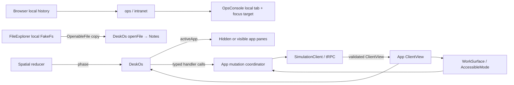
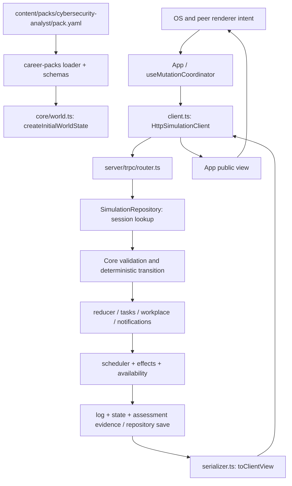
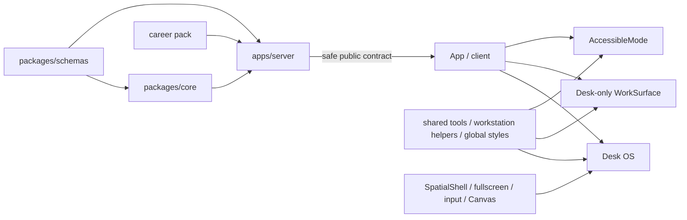

# Desk OS architecture map

Snapshot: 2026-09-20, `main`, HEAD `3e8fe62382ed1b9d7aa83a8fab47bb28c66500ba`, including pre-existing local edits. Paths are repository-relative. This maps existing code, not proposed architecture. See [audit](DESK_OS_AUDIT.md) for verification and limitations.

## Entry and component ownership

```text
apps/web/src/main.tsx
└── index.tsx: App — session, public view, tutorial/assessed flow, mutations
    ├── components/shell.tsx: ShiftBriefing
    ├── components/DebriefView.tsx
    └── experience/ExperienceShell.tsx
        ├── walk: world/SpatialShell.tsx
        │   ├── world/FloorMap.tsx
        │   ├── world/RoomCanvas.tsx [lazy]
        │   │   ├── rooms/SocRoom.tsx → desk_player hotspot
        │   │   ├── PlayerController.tsx → seating camera / movement
        │   │   └── effects/SceneEffects.tsx [lazy, adaptive]
        │   └── world/deskOs/LaptopOverlay.tsx [only at desk]
        │       └── DeskOs.tsx
        │           ├── LockScreen.tsx [local simulated credentials]
        │           ├── os/Desktop.tsx [launcher]
        │           ├── os/BrowserApp.tsx
        │           │   ├── static Company intranet article
        │           │   └── OpsConsole.tsx [kept mounted]
        │           │       ├── tabs.ts [seven fixed console sections]
        │           │       ├── NotificationBanner / CaseRail / MutationStatus
        │           │       ├── DashboardHome / CalendarPanel
        │           │       └── SystemApp → SystemToolPanel
        │           ├── os/FileExplorer.tsx → openFileInNotes
        │           ├── os/Notes.tsx
        │           └── os/Taskbar.tsx
        ├── desk: components/WorkSurface.tsx → SystemToolPanel
        └── list: components/AccessibleMode.tsx [peer canonical controls]
```

Desk/list additionally expose `NonspatialResources`; walk mode exposes spatial break/Jules/HUD controls. These are relevant dependencies even though they are outside desktop windows.

### Shared tool dispatch

`apps/web/src/components/SystemToolPanel.tsx` dispatches on `WorkSystemId`:

| System ID         | Specialized view                                           | Canonical connections                                                      |
| ----------------- | ---------------------------------------------------------- | -------------------------------------------------------------------------- |
| `email`           | `tools/EmailTool.tsx`                                      | Artifact observation, contextual actions/task attempts                     |
| `alert_dashboard` | `tools/AlertTool.tsx`                                      | Alert/context/history artifacts and actions                                |
| `ticket_queue`    | `artifacts.tsx`: ArtifactList, ArtifactDetail, NotesEditor | `ticketNotes[eventId]`, notebook, remaining summary task                   |
| `knowledge_base`  | GuideSearch, InventoryLookup, RecordQueryTool              | Guide search and observation connected; structured-query submit not passed |
| `team_chat`       | TeamChatTool                                               | Authored thread, public reminders, ask-manager and shift actions           |

`WorkInteraction` composes `CaseReview`, `TaskInteraction` and ordinary action buttons. `TaskInteraction` calls `WorkTaskPanel`; it selects `SourceEvidence`, `RecordComparison` or normal option controls. These are conditional renderers, not separately installed apps. Nine released task gates suppress their current task views; `login-ticket-summary` remains gated.

## State flow and lifetimes



| State                                                        | Owner / source                                | Lifetime and meaning                                                                                |
| ------------------------------------------------------------ | --------------------------------------------- | --------------------------------------------------------------------------------------------------- |
| Canonical session/view                                       | `index.tsx` + server repository               | Survives renderer changes during current App session; current client creates new session on reload. |
| Pending/error/retry/success                                  | `useMutationCoordinator.ts`                   | Shared mutation boundary; protects duplicate/stale requests.                                        |
| Spatial phase/visited desk                                   | `world/presentation.ts`, SpatialShell reducer | Local presentation. Sitting always selects login. Mode unmount loses this state.                    |
| Login fields/error/timer                                     | `LockScreen.tsx`                              | Local component; fixed credentials; no identity or permission authority.                            |
| Active app/opened file                                       | `DeskOs.tsx`                                  | Preserved across app hiding, lost on leaving desk.                                                  |
| Files/location/selection/cut ID                              | `FileExplorer.tsx`                            | Local fake filesystem; not evidence, not persisted.                                                 |
| Scratch text                                                 | `Notes.tsx`                                   | Local text, independent of open file and canonical notebook.                                        |
| Browser history/reload timer                                 | `browserState.ts`, BrowserApp                 | Local IDs/index; timer feedback only.                                                               |
| Console tab/notification target                              | `OpsConsole.tsx`                              | Local navigation; waits for canonical acknowledgement before focus.                                 |
| Selected event/artifact/draft                                | `SystemApp`, SystemToolPanel, NotesEditor     | Local component state; survival depends on mount path. Explicit save writes canonical notes.        |
| Observed records, work progress, notes, clock, notifications | Core WorldState → public ClientView           | Deterministic, repository-backed; authoritative across all views.                                   |

App switch hides panes rather than unmounting. Console sections do not all remain mounted: Dashboard/Calendar/SystemApp branch selection can unmount detail components. Do not generalize app-level state retention to every tool draft or nested section.

## Canonical data and action path



Transport methods connected from current UI (`apps/web/src/client.ts`): `session.create`, `simulation.performAction`, `simulation.performWorkplaceInteraction`, `simulation.submitTaskAttempt`, `simulation.respondToNotification`, `debrief.get`. Local workstation login is outside this transport.

Artifact data path: authored artifact → server state → legal preview → `open_artifact` or authored observation effect → observed body/metadata projection → professional tool. FileExplorer does not participate. Do not send raw pack/rules/hidden data to a new file manager or browser page.

Notification path: simulated-time threshold → pending event activation → notification state → public view → first unread banner → canonical response → navigation/focus. No desktop mount/login hook creates a notification. No websocket/push subscription is needed by the inspected implementation; updates arrive through request responses.

Persistence: `apps/server/src/repository/types.ts` defines interface; `repository/in-memory.ts` is development implementation; `db/repository.ts` stores persistent sessions using Postgres. `main.ts:53` selects based on DATABASE_URL. No OS-local state is included in this repository contract.

## Partial or disconnected implementation branches

```text
RecordQueryTool.onQueryRecords   -- missing parent callback --> App/client payload
router queryPayload             --> core query engine        [implemented]
core discoverEvidenceFacts      -- no runtime caller found   [foundation]
untracked structured-ticket.*   -- no reducer/router wiring  [in-flight]
untracked WindowChrome          --> untracked appCatalog     [no mounted caller]
focus_desk reducer event        -- no dispatch caller found  [dormant phase]
```

`RecordQueryTool` can render supplied `view.queryResults`, but actual app cannot submit its structured form. Tests supplying handlers do not close this integration gap. Future work must recheck current branch before assuming these gaps remain.

## Dependency and blast-radius map



Confirmed high-impact boundaries:

1. Shared tool changes can change desk/list behavior and canonical action parity.
2. New document/browser data must preserve serializer observation gating and hidden-state exclusion.
3. Window mounting changes can lose draft/selection state or leave hidden focus targets; current state is not held in a durable app registry.
4. Moving notifications globally must preserve acknowledgement/retry ordering and event-target focus.
5. Startup immersion must not create or advance canonical work through real-time boot/login delays.
6. Native fullscreen, F handling and spatial input share browser event scope; focus behavior needs integration verification.
7. Global CSS is shared across console, work surfaces and other screens; selectors are not isolated theme modules.
8. Current SOC naming is embedded in shell URLs/company text and some core helpers. Generalization risk is inferred; existing three-renderer coupling is confirmed.

Build/testing entry points: root `package.json`, `vitest.config.ts`, `apps/web/package.json`, `apps/web/vite.config.ts`; relevant tests and fresh results are recorded in the main audit. No production database or release gate verification is implied by web build success.
