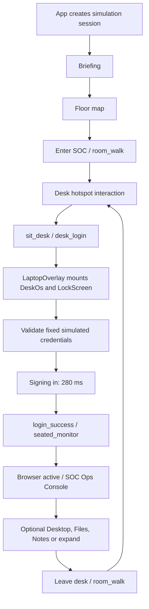

# Desk OS current-state audit

> **Supersession (2026-09-22):** this file is a **historical implementation inventory** (2026-09-20). It correctly described three peer renderers and open product questions **at that time**. Product decisions and the implementation plan now live in [DESK_OS_AUDIT_HANDOFF.md](DESK_OS_AUDIT_HANDOFF.md) and [DESK_OS_OVERHAUL_PLAN.md](DESK_OS_OVERHAUL_PLAN.md): one experience (3D + Desk OS), peer Walk/Desk/List product modes removed after migration. Do not update the body below to pretend the audit already knew the new direction.

Audit date: 2026-09-20. Repository checkout: Career Expo; branch `main`; HEAD `3e8fe62382ed1b9d7aa83a8fab47bb28c66500ba`. Scope: current working tree, including pre-existing uncommitted work. This is an implementation inventory for architecture planning, not an overhaul design or release approval.

## Evidence and baseline

Paths below are repository-relative. Component/function names identify the inspected implementation; line numbers are snapshot anchors, not permanent identifiers. Companion documents: [architecture map](DESK_OS_ARCHITECTURE_MAP.md), [gap matrix](DESK_OS_GAP_MATRIX.md), [architect handoff](DESK_OS_AUDIT_HANDOFF.md).

Evidence comes from direct source inspection, a read-only runtime pack probe, existing jsdom tests, web typecheck, and production build. No live browser, GPU profiling, screen-reader session, production database, or full player playthrough was performed. Visual descriptions describe JSX/CSS, not screenshot-verified appearance. “Absent” means absent from the inspected implementation and its call sites, not impossible in another branch.

Orca `worktree current --json` verified the path, branch and HEAD above. Its worktree comment references an older movement branch and test result; not used as current evidence. `AGENT_CONTEXT.md` also contains stale worktree paths, “3D not started,” older task counts and older phishing-flow claims. Current code takes precedence for implementation inventory. Governing boundaries remain in `career-sim-build-spec.md`, `AGENTS.md`, the approved `docs/superpowers/specs/2026-08-28-workplace-systems-overhaul-design.md`, and the canonical `docs/superpowers/specs/interactivity-and-content-depth-design.md`. Their target features are not automatically implemented features.

Pre-existing tracked edits: `apps/web/src/components/WorkSurface.tsx`, `packages/schemas/src/actions.ts`, `packages/schemas/src/index.ts`, `packages/schemas/src/world.ts`. Relevant untracked files: `apps/web/src/world/deskOs/os/WindowChrome.tsx`, `appCatalog.ts`, `packages/core/src/structured-ticket.ts`, `structured-ticket-legality.ts`, `packages/schemas/src/ticket-update.ts`, and a benign-triage test. Other pre-existing untracked brain documentation, tests and backup directory were outside scope. Nothing was reverted or committed.

No callable `project-memory` tool/resource was exposed in this session. Shared-memory retrieval/write could not be verified. These four repository documents are the durable handoff; no Orca task completion or Kiro acceptance is claimed.

Status terms: **implemented** = connected code; **partial** = connected subset with material missing behavior; **simulated** = intentionally bounded/local substitute; **prototype** = code present without active callers; **planned** = specification only; **absent** = no implementation found. Status is separate from verification confidence.

## A. Entry and startup

`apps/web/src/main.tsx` mounts `App` in React StrictMode. `apps/web/src/index.tsx:29` owns session creation, canonical `ClientView`, tutorial/assessed phase, briefing and experience mode. A session is created before workstation login. Initial loading reads “Preparing workplace…”; startup failure has retry handling. `ShiftBriefing` in `components/shell.tsx` opens the dashboard surface.

`experience/ExperienceShell.tsx` chooses three peer renderers:

- Walk the office: `world/SpatialShell.tsx`, floor map, then lazy `RoomCanvas`.
- Desk only: `components/WorkSurface.tsx`, directly. **This does not render DeskOs, login, Files, Notes or Browser chrome.**
- Simple list: `components/AccessibleMode.tsx`, directly.

Actual walk-mode sequence:



Physical interaction uses the `desk_player` hotspot; `world/rooms/SocRoom.tsx:216` handles nearby E interaction, while `SpatialShell.handleInteract` dispatches `sit_desk` (`SpatialShell.tsx:243`). The shell also exposes an interaction button. Camera seating is presentation in `PlayerController.tsx:264`; the DOM overlay is outside Canvas. `SpatialShell.tsx:392` mounts it only for desk phases.

`world/presentation.ts:34` always enters `desk_login` when sitting. `visitedDesk` influences guidance, not authentication. `LockScreen.tsx` presents company branding, SOC-07, “Locked,” username/password fields, a yellow credentials note, inline error, and disabled “Signing in…” submit. Credentials in `world/deskLogin.ts` are `day1.analyst` / `FirstDay!`: intentional simulation data, not account authentication. Successful local comparison waits 280 ms and dispatches presentation-only `login_success`. No canonical action, network authentication, boot process, power button, session token, logout, idle lock or workstation user management exists.

After login the **active app is Browser**, initialized in `DeskOs.tsx:54`, not the icon desktop. The pre-mounted console begins on Dashboard while locked; tutorial `guided` mode can then select the guidance system. This differs from desk → activation → OS boot/login → desktop → incoming manager message.

`LaptopOverlay.tsx` implements whole-workstation fullscreen, F outside typing targets, fullscreen cleanup, and optional inert/disabled handling. This is not individual-window maximize. The `focus_desk` presentation phase exists; no current dispatch caller was found for entering it. Native fullscreen is the connected expansion path.

State lifetime: hidden apps remain mounted, preserving their local state across app switches and intranet navigation. Leaving the desk removes `LaptopOverlay` and all OS children; returning resets login, active app, browser history, files, scratch notes and selections. Changing experience mode also unmounts the spatial shell. Canonical work remains in App/server for the existing session. Full page refresh creates a new session in the current web client; server persistence does not imply client resume UI.

## B. Desktop environment

| Feature                          | Status              | Current implementation / boundary                                                                                                                                   |
| -------------------------------- | ------------------- | ------------------------------------------------------------------------------------------------------------------------------------------------------------------- |
| Wallpaper/background             | Simulated           | `styles.css:3365` uses dark radial/linear gradients; no wallpaper image or selection.                                                                               |
| Desktop icons                    | Implemented         | `Desktop.tsx` provides single-click Browser, Files and Notes buttons with B/F/N monograms. No file icons from FakeFs.                                               |
| Taskbar/dock                     | Implemented         | `Taskbar.tsx`: Desktop plus fixed three app buttons, active indicator, shift clock, expand and leave. All entries are pinned; no running-window model.              |
| Launcher                         | Partial             | Icon grid and taskbar only; no menu, app search or application installation.                                                                                        |
| Clock                            | Implemented         | `formatShiftClock(view.simClock)` in `systems.ts`; simulated 08:00 base, not OS wall time.                                                                          |
| System indicators                | Simulated/partial   | Console has “Secure,” energy and objective; no network, audio, battery, tray or OS settings subsystem.                                                              |
| Notifications                    | Partial             | Canonical work banner inside Ops Console, not global desktop notifications.                                                                                         |
| Window manager                   | Absent              | `DeskOs.activeApp` selects one full-workspace pane; hidden siblings stay mounted. No window instances, geometry, stacking or ownership model.                       |
| Window chrome                    | Simulated/prototype | Console traffic-light spans decorative. Untracked `WindowChrome.tsx` also decorative and has no callers.                                                            |
| Focus / z-order                  | Partial             | Browser DOM order, task/artifact heading focus and fullscreen; no active-window focus manager or z-order.                                                           |
| Drag / resize / minimize / close | Absent for windows  | Files can be dragged between folders, which is unrelated. App switching hides panes; no close operation.                                                            |
| Maximize                         | Partial             | Whole workstation fullscreen only; no per-app maximize.                                                                                                             |
| Keyboard / mouse                 | Partial             | Native buttons/forms, Enter opens file, Space selects, accessible Cut/Paste buttons, F expands. No OS app-switch shortcut or arrow-key window/tab navigation model. |
| Session persistence              | Partial             | Mounted-state preservation only for OS. Canonical work persists through server repository.                                                                          |
| Customization                    | Absent              | No themes, wallpaper, icon arrangement or desktop preferences. Mouse sensitivity is a separate spatial preference.                                                  |

Structure is reusable as an app-host starting point, not an existing window manager. Desktop/taskbar catalogs are duplicated inline. Untracked `appCatalog.ts` centralizes metadata but only its untracked `WindowChrome` consumer imports it. Its presence must not be mistaken for a completed integration.

## C. Application inventory

There are **three shell applications**, a desktop launcher, **two simulated browser destinations**, and **seven Ops Console tabs**. Five of those tabs are canonical workplace systems. No standalone terminal, email app, chat app, document suite, package installer or settings app was found.

All shell sources below live under `apps/web/src/world/deskOs/`; workplace sources under `apps/web/src/components/`.

| Surface          | Entry and visual structure                                                          | Interactions / data / cross-app role                                                                                                                                                                    |
| ---------------- | ----------------------------------------------------------------------------------- | ------------------------------------------------------------------------------------------------------------------------------------------------------------------------------------------------------- |
| Browser          | `os/BrowserApp.tsx`; taskbar/icon; navigation row + bookmarks + page                | Two local page IDs, persistent mounted Ops Console; sole shell gateway to canonical work. History local only.                                                                                           |
| Files            | `os/FileExplorer.tsx`; taskbar/icon; toolbar + folder sidebar + file list + preview | Four static text files, selection, open, cut/paste, drag move; opens file in Notes. No scenario integration.                                                                                            |
| Notes            | `os/Notes.tsx`; taskbar/icon/file open; opened-file article + textarea              | Read-only file body plus independent editable scratch pad. Does not save into file or canonical notebook. Local mounted state only.                                                                     |
| Company intranet | Browser bookmark; inline `os-intranet` article                                      | Static paragraph mentioning office news, lunch menus and helpdesk; those services are not implemented.                                                                                                  |
| Dashboard        | `DashboardHome.tsx`; `tabs.ts` home                                                 | Guidance CTA, system tiles, open counts and shift time from ClientView. Clicking opens console tab.                                                                                                     |
| Alerts           | `SystemApp` → `SystemToolPanel` → `tools/AlertTool.tsx`                             | Event queue, record timeline, unopened/opened state, body and metadata after observation; canonical work actions. No live SIEM feed.                                                                    |
| Email            | `SystemApp` → `tools/EmailTool.tsx`                                                 | Sender/time parsed from safe authored summary, message list, explicit open, read state and body. No general compose/send/attachments/SMTP. Actions provide bounded work progression.                    |
| Tickets          | `SystemToolPanel.tsx` ticket branch                                                 | Artifact list/detail, canonical per-event investigation notes, canonical personal notebook, task composer when gated, CaseReview. No complete ticket lifecycle application.                             |
| Guides           | `tools/GuideSearch.tsx`, `InventoryLookup.tsx`, `RecordQueryTool.tsx`               | Local guide filter, separate canonical guide-search action when available, exact device lookup and artifact opening. Structured record-query form exists but is not wired to submission in current app. |
| Team             | `tools/TeamChatTool.tsx` + WorkInteraction                                          | Observed authored Morgan thread, public task reminders, selected operational messages, ask-manager/other canonical actions. No general chat composer or sent-message transport/history model.           |
| Meetings         | `DashboardHome.CalendarPanel`                                                       | Visible email work, available Morgan help and optional break checkpoints; opens Email. Explicitly not scheduled meetings; no calendar CRUD or progression gate.                                         |

`tabs.ts:8` gives console paths such as `verdaly://mail/inbox`, `verdaly://cases`, and `verdaly://kb`; these are display strings, not browser/network routes. Console navigation shares the same ClientView and handler props. Saved observations, notes, actions and case outcomes connect tools; local selection and unsaved input do not constitute canonical evidence.

Important reachability qualification: specialized task components exist, but current pack releases nine of ten task bindings. `availability.target` omits their task IDs; `serializer.toClientView` emits tasks only for actions retaining task IDs. Thus source highlighting, record comparison and most option steps are reusable legacy implementations, not the currently active handoff/investigation flow. `login-ticket-summary` remains gated and can still render `WorkTaskPanel`'s build-summary interaction. Initial runtime ClientView contains zero tasks.

## D. File manager and virtual filesystem

`os/useFakeFs.ts` is a pure in-memory model, despite its hook-like filename. `FakeFs` contains a fixed folder list and `Record<FsFolderId, FsFile[]>`; file fields are only `id`, `name`, `body`. `FileExplorer` owns this state with `useState(initialFakeFs)`. No host filesystem, IndexedDB, storage API, backend filesystem, path resolver or canonical artifact ID mapping exists.

| Capability                | Status and evidence                                                                                                    |
| ------------------------- | ---------------------------------------------------------------------------------------------------------------------- |
| Hierarchy/navigation      | Partial: three flat locations, `desktop`, `documents`, `downloads`; folder buttons change one enum. No nested tree.    |
| Breadcrumb/path bar       | Absent. Current folder appears in list accessible label and active sidebar button.                                     |
| Sidebar/locations         | Implemented: fixed location buttons with file counts and drop targets.                                                 |
| Back/forward/up           | Absent.                                                                                                                |
| Types                     | Simulated: `.txt` suffix sets display data attribute; all seeded files contain plain text.                             |
| Selection/open            | Implemented: click toggles single selection; double-click or Enter opens; Open toolbar button is keyboard alternative. |
| App association           | Partial: every file opens in Notes through `DeskOs.openFileInNotes`; no MIME/extension registry.                       |
| Move                      | Implemented locally: `moveFile`, drag/drop `text/os-file-id`, Cut and Paste here buttons. No Ctrl-X/V binding.         |
| Rename/copy/delete/create | Absent. Cut is a local file-ID clipboard, not system clipboard.                                                        |
| Context menu/search/sort  | Absent; list preserves array order, moves append to destination.                                                       |
| Permissions               | Absent; no restricted directories or access metadata.                                                                  |
| Persistence               | Mounted React state only. No disk save, cross-session storage or file editing.                                         |

Seeded files: Desktop `welcome.txt`; Documents `shift-brief.txt` and `field-notes-draft.txt`; Downloads `vpn-setup.txt`. Their text is authored directly in source. They are genuinely openable/movable local objects, but **not canonical workplace evidence or scenario documents**. Moving a file to the fake Desktop does not create a launcher icon. Notes shows a copied `OpenableFile` body; its scratch textarea does not modify that body.

Actual mission artifacts instead live in `content/packs/cybersecurity-analyst/pack.yaml`, use canonical observation and appear in workplace tools. Bridging these two namespaces would change product semantics and privacy boundaries. Nothing here requires a real host filesystem.

## E. Browser

Classification: **React page viewer simulating browser chrome**, not browser engine, iframe wrapper, embedded webview or network proxy.

`os/browserState.ts` defines only `ops` and `intranet`. `useBrowserHistory` stores page IDs and an index; navigate truncates forward history and ignores consecutive duplicates. Back/forward are bounded. It has no history-list UI and no persistence beyond mount.

`BrowserApp.tsx` address input is read-only. Two fixed bookmark buttons navigate local content. Bookmarks cannot be added, edited, reordered or removed. No browser tabs, new-tab button, per-tab state, URL entry, URL parsing, arbitrary links or browser error page exist. The seven tabs inside OpsConsole are application sections, not browser tabs; their displayed URL does not update outer browser history or address.

Reload shows a 400 ms cosmetic live-region message and disables its button; it does not refetch or reset work. Reduced-motion preference makes reload return immediately. OpsConsole stays mounted while intranet is shown. No simulated network loading beyond this reload feedback; canonical mutations have their own real request states.

Mission connection is entirely through the rendered OpsConsole and callbacks. Neither browser navigation nor reload advances simulated time or creates evidence. The second website is placeholder content, while the first contains all professional systems.

## F. Notifications and communications

`packages/core/src/world.ts:57` creates notifications only for definitions whose events start active. The current pack defines one notification (`routine-scanner-arrived`, `pack.yaml:679`), tied to a pending routine event. The runtime probe confirms **zero notifications at initial state**.

First assignment comes from active event templates at session creation: `handoff-1` and `suspicious-login-1`. `guidance.ts:11` prioritizes `read_handoff`, then `acknowledge_handoff`. Login does not create the assignment or schedule a manager introduction. The initial Morgan welcome is text in `chat-morgan` (`pack.yaml:1312`); it is an artifact requiring observation, not a newly delivered desktop toast.

Routine interruption activates when canonical actions advance `simClock` to at least 25. `scheduler.activatePendingEvents` creates notification and consequence; `NotificationBanner` shows first unread notification. Handle now, Snooze 15 minutes (once), and Continue current case call canonical `respondToNotification`. Handle waits for accepted state before OpsConsole changes tab/focus. Snooze wakes on simulated time, not elapsed reading time. The serializer omits notifications for events no longer active; no complete notification-history UI exists.

Banner lives inside OpsConsole: hidden during lock, Files, Notes, Desktop or intranet use. No taskbar badge, global toast queue, sound, notification center or click-to-open app from outside Browser exists. Other peer renderers have their own shared banner placements.

Morgan is authored Security Operations Manager. `effects.ts:98` has case-specific procedural/context guidance; `ask_manager` records a consequence and marks the event consulted, while `availability.ts` limits repeat offers. This is deterministic work guidance; the separate server free-text/AI route is not a connected desktop chat composer. `TeamChatTool` renders authored artifacts, task reminders and operational messages whose strings start with `Morgan `. Some current manager guidance strings do not have that prefix. Therefore do not assume Team displays all canonical manager replies; that presentation mismatch is relevant to communication redesign. No new bug fix was attempted.

Persistence: notification status, observed chat artifact and operational consequence ledger are canonical. There is no independent conversation database in Desk OS. `App` still contains manager-surface state, but current OS communication path is Team/shared tool callbacks, not a new autonomous NPC session.

## G. SOC mechanics and current content

Runtime pack inspection produced 3 event instances, 16 artifacts, 10 task definitions (9 released), 5 datasets (`auth`, `vpn`, `devices`, `alerts`, `scanner`). Active at creation: unfamiliar login and incomplete handoff. Pending: routine scanner review at simulated minute 25. There is no active phishing or separate false-positive event in this loaded pack; older descriptions exceed current event inventory.

Canonical path: `world.ts` builds authored state; `availability.ts` offers legal event-targeted actions; `reducer.applyAction` validates, applies effort/time and effects; scheduler activates/ends work and applies delayed consequences; `serializer.toClientView` projects public state. `apps/server/src/trpc/router.ts` invokes these functions, writes log/evidence/session and returns validated public views.

Mechanics with actual connected player actions:

- Open authored handoff/email/alert/device/history/procedure records through `open_artifact`, or observe specified records through action effects. Observed bodies/metadata are withheld before observation (`serializer.ts:151`).
- Advance handoff and investigation using available action IDs: review alert, inspect context/history, check inventory, document ticket, ask manager, search procedure, escalate or dismiss. Released task bindings mean many steps now use ordinary action buttons.
- Filter public guide documents locally; separately submit canonical guide search to store query and apply authored effects. Exact inventory lookup operates over projected artifact keys, not a live asset service.
- Save free-text investigation notes to per-event `ticketNotes`; canonical personal notebook is a different field from shell Notes. Uncommitted drafts remain component-local.
- Complete remaining login-ticket summary via selected authored options. `tasks.exactRequiredSelection` compares exact required IDs, validates opened source records and records progress; wrong task attempts return authored coaching without advancing work time. This remains a bounded exercise mechanic, not free-form analyst judgment evaluation.
- Escalation produces authored senior-review handoff outcome. Dismissal can schedule related activity after 40 simulated minutes (`pack.yaml` suspicious-login action effects). No real containment, account lock, remote command or external security service is invoked.
- Canonical finite energy/break resources and Jules interaction exist across renderers; an OS overhaul must not strand recovery controls.

Structured query engine is **implemented server-side**: `core/query.ts`, reducer query branch, append-only query history, schema-filtered public results, and router `queryPayload`. `RecordQueryTool.tsx:132` has dataset filters, time-window validation, result tables/history and explicit submit handler prop. But `SystemToolPanel` passes only view/mutation state, and `client.ts` performAction has no queryPayload argument. Its current form cannot submit a structured query end-to-end. Presence of engine tests or form component is not proof of player reachability.

`core/evidence-facts.ts` exports a discovery helper. A source search found no connected runtime call from reducer/router; treat as implementation foundation, not automatic live fact discovery. Untracked structured-ticket modules and schema additions similarly are in-flight code, not verified current ticket workflow. `core/index.ts`, `reducer.ts` and router do not integrate them at this snapshot.

These findings describe mechanics, not professional-realism ratings. The separate research workstream should evaluate authored records, progression, decision wording, workload and task boundaries. Do not infer that adding OS chrome alone removes action-card or option-gate mechanics.

## H. Architecture and coupling

React 19 / TypeScript / Vite app; React Three Fiber, Drei, Three and postprocessing for the office; tRPC HTTP batch client; Zod runtime contracts; pnpm/Turborepo workspace; Vitest/jsdom/Testing Library and vitest-axe. Versions in package manifests are declared ranges; build resolved Vite 7.3.5 and test runner Vitest 3.2.6. No React Router, Redux, Zustand or desktop-window library appears in the application manifest or inspected OS implementation.

State uses hooks/reducers and handler props. There is no OS event bus. Browser page and console route state are separate React enums. Window `CustomEvent`/DOM events support fullscreen and spatial controls (`useFullscreen.ts`, SpatialShell), not canonical simulation messaging.

`useMutationCoordinator.ts` serializes UI mutations, suppresses duplicates, rejects stale session continuations and supplies retry/success state. `index.tsx` owns all canonical calls. Components should not bypass this boundary. `ClientView` is parsed at HTTP return; server owns rules, hidden state, observations and evidence.

Server persistence is selected in `apps/server/src/main.ts:53`: Postgres if DATABASE_URL exists, otherwise in-memory. Repository stores canonical sessions/logs; it does not store OS pane layout, Files, Browser history or scratch text. Deployment database availability and recovery are unverified. Current browser client starts new sessions rather than restoring a stored session after page reload.

Styling is mostly global `apps/web/src/styles.css`, with shared tool CSS and `experience/experience.css`. Dark panels, amber/teal accents, monograms, rounded buttons, laptop bezel and console traffic lights combine several visual motifs; no formal Linux desktop theme abstraction exists. `apps/web/index.html` fetches DM Sans, IBM Plex Mono and Syne from Google Fonts; CSS includes system fallbacks. Desktop wallpaper/icons require no bitmap asset. 3D props/textures are separate scene assets/procedural resources.

Confirmed coupling: all three renderers share SystemToolPanel/artifact/task controls and action contracts; DeskOs is reached only through SpatialShell; global CSS affects both OS and broader workplace; fullscreen key listeners coexist with spatial input; current company/page IDs and several guidance paths are SOC-specific. Core also contains explicit SOC references in serializer work-item categories and Morgan case guidance, despite older descriptions of complete career neutrality. No second implemented career was established; risk to future careers is inferred, while risk to present desk/list modes is confirmed by imports.

## I. Performance, accessibility and verification

Load path: initial app bundle includes ExperienceShell, SpatialShell and OS components through static imports. RoomCanvas is lazy, and SceneEffects is separately lazy. Desk/list do not instantiate Canvas. Walk mode leaves Canvas mounted behind the workstation. `RoomCanvas.tsx` is memoized; seated mode disables shadows and its adaptive quality provider disables composer effects/reduces quality. This is existing optimization, not a measured frame-rate guarantee.

All four OS panes mount together, including while locked. CSS `hidden` preserves state but not React subscription/render lifecycles; updated ClientView can rerender hidden console children. Possible optimization boundary, **not evidence of lag**. Browser history can grow with repeated bookmark navigation; datasets/query history can increase retained canonical/view size. No measured memory leak, heap budget, input-latency baseline or Desk OS benchmark was found in inspected tests. Scene animation/frame costs require GPU profiling, not source complexity judgments.

CSS includes gradients/shadows, hover transitions and suggested-tab pulse with reduced-motion rules. Reload timer respects reduced motion; login's 280 ms timer does not check it. Small-screen CSS at 820 px rearranges console queues/status; workstation frame uses viewport-limited dimensions. Taskbar still has three column groups and browser/console nested chrome. Narrow-screen, zoom, touch and native fullscreen behavior need actual browser validation; no claimed overflow defect without that evidence.

Keyboard foundations: native controls, labelled inputs, hidden app panes, file Enter/Space behavior, drag alternative, live status text, mutation/task feedback focus and artifact heading focus. Limits: no full OS focus restoration contract, no multiwindow navigation, no roving arrow-key tab behavior in console tabs. Tests cover selected roles/keyboard paths, not complete assistive-technology conformance.

### Checks executed

```sh
pnpm exec vitest run apps/web/test/desk-os.test.tsx apps/web/test/os-shell.test.tsx apps/web/test/os-shell-harden.test.tsx apps/web/test/experience-shell.test.tsx apps/web/test/workplace-parity.test.tsx apps/web/test/workplace-golden-path.test.tsx apps/web/test/task-recovery.test.tsx apps/web/test/shift-lifecycle-recovery.test.tsx
pnpm --filter @sim/web typecheck
pnpm --filter @sim/web build
```

- Focused suite: **51 passed, 6 failed**, 6 files passed / 2 failed, 8.54 s. All 19 desk-os, 3 os-shell, 7 os-shell-harden, 4 experience-shell, 9 workplace-parity and 4 task-recovery tests passed; lifecycle suite 5/6 passed. Node emitted `--localstorage-file` warning.
- Failures: lifecycle fixture expects initial task but current view has none; three golden paths report `Missing saved handoff before decision`; parity aggregate expects three completed traces but has zero; tutorial break path reports `Energy is already full`. These invalidate a blanket golden-path/completion claim. Released task bindings explain the missing initial task directly; remaining failures were recorded, not exhaustively diagnosed or fixed.
- Web typecheck: passed, exit 0.
- Web build: passed, exit 0; 753 modules transformed. Vite warns about chunks over 500 kB. Output: app JS 414.17 kB / 120.06 kB gzip; RoomCanvas 1,014.13 / 270.99; SceneEffects 82.94 / 22.81; CSS 74.01 / 14.19. These are build artifacts, not browser transfer or render timings.
- Read-only `pnpm exec tsx -e` probe imported `loadDefaultCybersecurityPack`, `createInitialWorldState`, `toClientView`, created seed-1 in-memory state, and printed counts/event IDs/task release flags. Results appear in sections F/G. No server, database or saved session was changed.
- No dependency install, application edit, new branch, migration, paid AI evaluation or full-repository test sweep. Build may update ignored output/cache files.

## J. Product comparison and audit limits

The current OS is a small local app switcher around a substantive shared SOC web console. Preserve public-view/action boundaries, observation gating, mutation recovery, shared professional-tool components and scene/DOM separation. Desktop shell itself has limited state abstractions, no true window manager, a flat decorative filesystem and two-page simulated browser.

Detailed scope/risk comparisons are in [DESK_OS_GAP_MATRIX.md](DESK_OS_GAP_MATRIX.md). The architect must account for current content migration, peer-renderer parity, canonical document visibility, separate scratch/canonical notes, desktop state loss, ungated versus still-gated tasks, and partial query/ticket integration. Remaining unknowns: live visual quality, low-end performance, accessibility across real browsers, durable production session restoration, team memory/task status, and ownership/landing status of local in-flight code.
